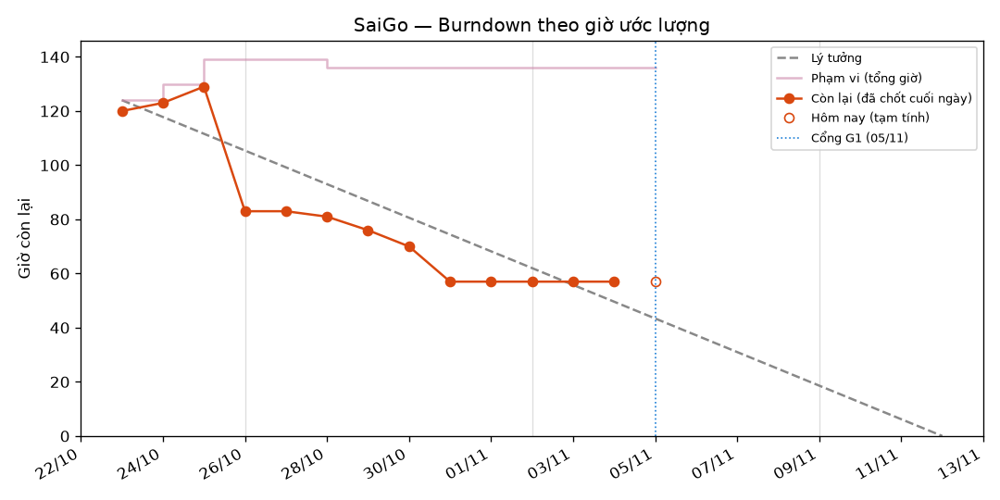

## 📉 Burndown SaiGo

_Tự động cập nhật 05:40 05/11/2026 (giờ VN) bởi workflow `tracking.yml` từ trạng thái issue/PR thật. Số những ngày đã qua được chốt cuối ngày và không bị sửa lại; số hôm nay là tạm tính. Cách tính ở đầu file `scripts/tracking/burndown.py`._

- **Phạm vi hiện tại:** 136 giờ ước lượng, 46 task (đã cắt 3 giờ)
- **Đã đóng:** 79 giờ — có bằng chứng (PR/commit) 79 giờ · **Còn lại:** 57 giờ, 19 task mở
- **Đường lý tưởng hôm nay:** 43.4 giờ → **chậm** hơn kế hoạch 13.6 giờ
- Mốc: cổng G1 05/11 · final ready 12/11 · thuyết trình 19/11 · nộp 22/11

### Theo tuần

| Tuần | Giờ đến hạn | Giờ hoàn thành | Task xong | Còn lại cuối tuần | PR merge | Lượt review |
|---|---:|---:|---:|---:|---:|---:|
| Tuần 1 · 19–25/10 | 27 | 10 | 3 | 129 | 2 | 3 |
| Tuần 2 · 26/10–01/11 | 30 | 69 | 24 | 57 | 36 | 60 |
| Tuần 3 · 02–08/11 | 62 | 0 | 0 | 57 | 2 | 3 |
| Tuần 4 · 09–15/11 | 17 | 0 | 0 | — | 0 | 0 |

### Theo thành viên

| Thành viên | Giờ được giao | Giờ hoàn thành có bằng chứng | Task xong | Đóng tay | Task mở | PR đã merge | PR đã review (có nội dung) |
|---|---:|---:|---:|---:|---:|---:|---:|
| Bảo (@dobaovlu) | 18.2 | 7.0 | 3 | 0 | 6 | 3 | 16 |
| Duy Anh (@anh7032) | 34.8 | 30.0 | 10 | 0 | 3 | 19 | 16 |
| Minh (@Jayson135724) | 28.8 | 13.0 | 5 | 0 | 8 | 5 | 29 |
| Tiến (@NeitLN) | 54.2 | 29.0 | 10 | 0 | 11 | 13 | 5 |

### Đóng trong 7 ngày qua

- 31/10 · #25 T60 · Bộ chạy benchmark và 1.000 truy vấn vùng demo (4 h, qua PR)
- 31/10 · #24 T55 · Case demo và kiểm thử thủ công (3 h, qua PR)
- 31/10 · #18 T42 · Kịch bản ùn tắc cho demo (2 h, qua commit)
- 31/10 · #13 T31 · Chuyển GraphML thành `saigo-graph/1` và báo cáo kiểm tra (4 h, qua commit)
- 30/10 · #21 T52 · UI: chọn hai điểm, vẽ hai tuyến, bảng so sánh (3 h, qua PR)
- 30/10 · #12 T30 · Chốt vùng và tải dữ liệu một lần (3 h, qua PR)

### Ghi chú

- Backlog ban đầu (40 task, ước lượng giờ) do Tiến lập từ `docs/TASKS.md` bằng script ngày 23/10/2026; trạng thái sau đó do từng thành viên cập nhật. Không dựng lại dữ liệu trước ngày này.
- Ước lượng lấy cận trên của khoảng trong TASKS.md (ví dụ "2–3 h" → 3); "nhiều buổi" (essay) được giả định là 10 giờ.
- #1 đóng bằng commit trực tiếp trước khi bật bảo vệ branch `main`; từ đó mọi thay đổi phải qua PR có review.
- Số liệu từng ngày: [`daily.csv`](https://github.com/NeitLN/SaiGo/blob/tracking/daily.csv) trên branch `tracking`.
