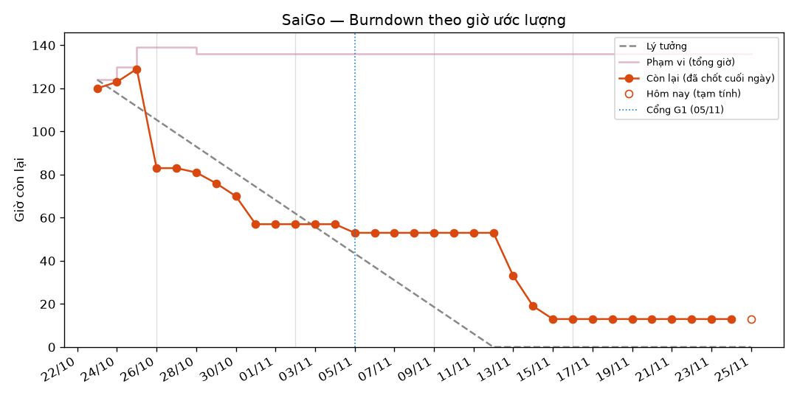

## 📉 Burndown SaiGo

_Tự động cập nhật 07:34 28/11/2026 (giờ VN) bởi workflow `tracking.yml` từ trạng thái issue/PR thật. Số những ngày đã qua được chốt cuối ngày và không bị sửa lại; số hôm nay là tạm tính. Cách tính ở đầu file `scripts/tracking/burndown.py`._

- **Phạm vi hiện tại:** 136 giờ ước lượng, 46 task (đã cắt 3 giờ)
- **Đã đóng:** 123 giờ — có bằng chứng (PR/commit) 121 giờ, **đóng tay chưa có PR 2 giờ** · **Còn lại:** 13 giờ, 3 task mở
- **Đường lý tưởng hôm nay:** 0 giờ → **chậm** hơn kế hoạch 13.0 giờ
- Mốc: cổng G1 05/11 · final ready 12/11 · thuyết trình 19/11 · nộp 22/11

### Theo tuần

| Tuần | Giờ đến hạn | Giờ hoàn thành | Task xong | Còn lại cuối tuần | PR merge | Lượt review |
|---|---:|---:|---:|---:|---:|---:|
| Tuần 1 · 19–25/10 | 27 | 10 | 3 | 129 | 2 | 3 |
| Tuần 2 · 26/10–01/11 | 30 | 69 | 24 | 57 | 36 | 55 |
| Tuần 3 · 02–08/11 | 62 | 4 | 2 | 53 | 4 | 3 |
| Tuần 4 · 09–15/11 | 17 | 40 | 14 | 13 | 56 | 62 |
| Tuần 5 · 16–22/11 | 0 | 0 | 0 | 13 | 14 | 14 |

### Theo thành viên

| Thành viên | Giờ được giao | Giờ hoàn thành có bằng chứng | Task xong | Đóng tay | Task mở | PR đã merge | PR đã review (có nội dung) |
|---|---:|---:|---:|---:|---:|---:|---:|
| Bảo (@dobaovlu) | 11.0 | 11.0 | 5 | 0 | 0 | 5 | 15 |
| Duy Anh (@anh7032) | 31.5 | 31.5 | 11 | 0 | 0 | 25 | 16 |
| Minh (@Jayson135724) | 21.5 | 21.5 | 9 | 0 | 0 | 11 | 97 |
| Tiến (@NeitLN) | 72.0 | 57.0 | 20 | 1 | 3 | 71 | 9 |

### Đóng trong 7 ngày qua

- Chưa có

### Ghi chú

- Backlog ban đầu (40 task, ước lượng giờ) do Tiến lập từ `docs/TASKS.md` bằng script ngày 23/10/2026; trạng thái sau đó do từng thành viên cập nhật. Không dựng lại dữ liệu trước ngày này.
- Ước lượng lấy cận trên của khoảng trong TASKS.md (ví dụ "2–3 h" → 3); "nhiều buổi" (essay) được giả định là 10 giờ.
- #1 đóng bằng commit trực tiếp trước khi bật bảo vệ branch `main`; từ đó mọi thay đổi phải qua PR có review.
- Số liệu từng ngày: [`daily.csv`](https://github.com/NeitLN/SaiGo/blob/tracking/daily.csv) trên branch `tracking`.
