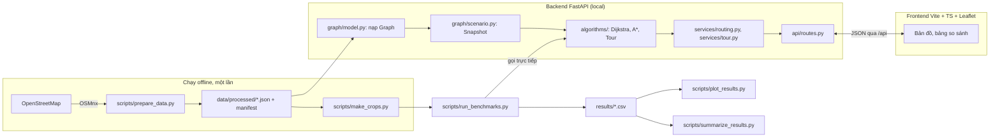

# SaiGo — Kiến trúc

Nhãn **[Đã chốt] / [Đề xuất] / [Giả định]** theo [PROJECT_BRIEF.md](PROJECT_BRIEF.md). Chi tiết cấu trúc dữ liệu ở [DATA_MODEL.md](DATA_MODEL.md).

## 1. Tổng quan



Ba ý chính:

1. **Thuật toán là hàm thuần.** `algorithms/` không import FastAPI, OSMnx hay Leaflet. Có thể test và benchmark mà không cần server.
2. **Dữ liệu tải một lần.** Sau bước offline, app chỉ đọc JSON. Demo chạy được khi không có Internet.
3. **Benchmark không đi qua HTTP.** Đo đúng thời gian thuật toán, không lẫn thời gian mạng hay vẽ bản đồ.

## 2. Công nghệ

| Thành phần | Chọn | Lý do ngắn gọn | Thay thế đã cân nhắc |
|---|---|---|---|
| Ngôn ngữ thuật toán | Python 3.11, `heapq`, `dataclasses` | Nhóm quen; `heapq` là binary heap chuẩn; code đọc giống pseudocode | C++ nhanh hơn nhưng khó giải thích, khó tích hợp |
| Tải dữ liệu đường | OSMnx (chỉ trong `scripts/`) | Tải mạng đường có hướng từ OSM, giữ đường một chiều, cạnh song song `(u,v,key)` | Overpass API thủ công: tốn công, dễ sai |
| Đối chứng | NetworkX (chỉ trong `tests/`) | Có `dijkstra_path_length` đáng tin để so chi phí | — |
| Backend | FastAPI + uvicorn | Đã có trong khung; schema Pydantic kiểm tra input | Flask: phải tự validate |
| Frontend | TypeScript thuần + Vite + Leaflet | Đã có trong khung; Leaflet đủ cho polyline/marker; không cần React (D6) | React: thêm thứ phải học |
| Test | pytest | Đã có trong khung và CI | — |
| Biểu đồ | Matplotlib | Xuất PNG/SVG cho essay và slide | — |
| Lưu trữ | File JSON/CSV | Không cần database; dữ liệu chỉ đọc | SQLite: thừa |
| Chạy trên Windows | Lệnh trong README (2 terminal) | PDF không yêu cầu `.exe` (D8) | PyInstaller: rủi ro với thư viện geospatial |

**Môi trường [Đã chốt 25/10]:**

- Máy thành viên dùng `scripts\setup_dev.ps1` (thêm `-Data` cho OSMnx). Script chỉ cài thư viện phụ thuộc, không dùng `pip install -e`, vì lệnh này lỗi trên Windows khi đường dẫn có dấu. CI (Linux) dùng `pip install -e ".[dev]" -c requirements-lock.txt`.
- **Python 3.11** là phiên bản chuẩn của nhóm và CI. Số liệu benchmark chỉ chạy trên 3.11.
- **Khóa phiên bản:** mọi thư viện được khóa trong `requirements-lock.txt`, dùng làm *constraints*. Thêm hoặc đổi thư viện trong `pyproject.toml` thì sinh lại file này trong cùng PR: tạo venv sạch Python 3.11, cài các nhóm `dev`, `bench`, `data`, rồi `pip freeze`. Giữ file ở dạng ASCII, vì pip trên Windows đọc file requirements bằng cp1252.
- **Lỗ hổng:** job `audit` trong CI chạy `pip-audit -r requirements-lock.txt` và `npm audit --audit-level=high`. Job này không bắt buộc để merge; job đỏ thì người tích hợp xử lý.
- Nếu OSMnx cài lỗi trên Windows: dùng môi trường conda-forge riêng, chỉ để chạy `prepare_data.py` (D9).

## 3. Cấu trúc module

Cấu trúc file trong repository tương ứng với các task đã hoàn thành theo [TASKS.md](TASKS.md) (các phần chưa hoàn thành được đánh dấu `[Chưa làm]`):

```text
backend/app/
  graph/
    model.py         Graph, GraphMeta, load_graph(), node_by_name()          (T01, T30)
    geo.py           haversine_m(), polyline_midpoint(), polyline_length_m() (T10)
    scenario.py      Snapshot, make_snapshot(), baseline_snapshot()          (T11)
                     Scenario, build_snapshot(), load_scenarios()            (T40)
    closures.py      reverse_twins(), close_both_ways(), validate_blocked()  (T41)
    snap.py          nearest_node() trong SCC, ngưỡng 150 m (SnapResult)    (T50)
  algorithms/
    result.py        SearchResult, dựng lại tuyến từ predecessor edge        (T11)
    dijkstra.py      dijkstra(), dijkstra_many()                             (T11, T72)
    astar.py         astar()                                                 (T20)
    heuristics.py    make_geo_heuristic(), geo_scale(), heuristic_report()  (T20, T22)
    tour.py          tour_cost, nearest_neighbor, two_opt, held_karp, choose_tour (T70, T71)
  services/
    routing.py       route() → snap, snapshot, chạy Dijkstra/A*, đo ms, hình học (T13, T51, T54)
    tour.py          cost_matrix() từ dijkstra_many, plan_tour()             (T72)
  api/
    schemas.py       Pydantic request/response (Health, Dataset, Route, Tour) (T13, T51, T54, T72)
    routes.py        /api/health, /api/dataset, /api/route, /api/tour        (T13, T51, T72)
  cli.py             python -m app.cli route ...                             (T12)
                     check-heuristic, route --scenario/--block [Chưa merge] (T22, T40; PR #110)
  main.py            FastAPI app, nạp Graph/Scenario (lifespan), geo_scale, reverse_twins (T13, T51)

scripts/
  prepare_data.py    OSM → JSON + manifest                                   (T30)
  make_crops.py      cắt lồng nhau cho thí nghiệm tăng quy mô                (T61)
  run_benchmarks.py  sinh truy vấn có seed, đo lặp, ghi results/             (T60, T62, T63)
  plot_results.py    vẽ biểu đồ benchmark và tour E5                         (T64, E5)
  summarize_results.py tổng hợp bảng kết quả Markdown và LaTeX               (T64, E5)
  check_attribution.py kiểm tra bản quyền dữ liệu OSM                        (T03)
  setup_dev.ps1      cài đặt môi trường phát triển Windows                   (T02)
  tracking/          quản lý backlog và burndown chart GitHub Projects       (T02)

tests/
  fixtures/          mini.json (6 node), mini_bad.json, mini_expected.json, scenarios_mini.json
  helpers/           random_graph.py (đồ thị ngẫu nhiên có tọa độ phục vụ kiểm thử)
  mini_cases.py      tập ca kiểm thử chuẩn trên đồ thị mini
  Unit thuật toán & đồ thị: test_graph_model.py, test_geo.py, test_dijkstra.py,
                     test_astar.py, test_heuristics.py, test_scenario.py,
                     test_closures.py, test_snap.py, test_tour.py
  Đối chứng:         test_oracle_networkx.py (đối chứng chi phí/no_path với NetworkX)
  Dữ liệu thật:      test_realdata.py, test_realdata_routes.py, test_realdata_closures.py
                     (chạy trên đồ thị thật, đánh dấu @pytest.mark.realdata)
  API:               test_health.py, test_api_route.py, test_api_t51.py,
                     test_api_edge_geometries.py, test_api_tour.py
  CLI & Scripts:     test_cli.py, test_crops.py, test_prepare_data.py,
                     test_run_benchmarks.py, test_plot_results.py,
                     test_summarize_results.py, test_check_attribution.py

frontend/src/
  main.ts            khởi tạo bản đồ Leaflet, gắn panel, điều khiển tìm đường & đóng cạnh (T14, T52, T53)
  api.ts             gọi /api/health, /api/dataset, /api/route, kiểu dữ liệu response (T14, T52)
  layers.ts          vẽ tuyến Dijkstra/A*, vùng ùn tắc, cạnh đóng tương tác  (T14, T52, T53)
  panel.ts           bảng điều khiển + bảng so sánh 4 hàng chỉ số            (T14, T52)
  style.css          stylesheet giao diện 3 cột                              (T14)
  Giao diện tour (kho + điểm giao) [Chưa làm]                                (T73)

data/
  config/            areas.json, speeds.json, scenarios.json
  demo/cases.json    case demo đã kiểm tra
  processed/         JSON đồ thị (gitignored), manifest.json (commit)
results/             <run_id>/queries.csv, measurements.csv, tour_measurements.csv, env.json
```

## 4. API [Đã chốt]

| Method | Path | Vai trò | Task |
|---|---|---|---|
| GET | `/api/health` | Kiểm tra server sống, trạng thái nạp dataset (`status`, `dataset_loaded`, `dataset_id`) | T13, T51 |
| GET | `/api/dataset` | Trả về `dataset_id`, số node/cạnh, danh sách kịch bản ùn tắc | T51 |
| POST | `/api/route` | Tìm đường giữa hai điểm (Dijkstra, A*), hỗ trợ kịch bản và đóng đường | T13 (skeleton), T51, T54 |
| POST | `/api/tour` | Lập tour khép kín qua nhiều điểm (Nearest Neighbor, 2-opt, Held–Karp) | T72 |

Đã bỏ ngày 26/10 ([PROJECT_BRIEF](PROJECT_BRIEF.md) D12): `/api/network` (vẽ toàn bộ mạng đường, T32) để tránh quá tải bộ nhớ và treo trình duyệt khi tải và vẽ hàng chục nghìn cạnh.

Ví dụ request/response của `/api/route`:

```json
{
  "source": {"lat": 10.7725, "lon": 106.6980},
  "target": {"lat": 10.7801, "lon": 106.6990},
  "algorithms": ["dijkstra", "astar"],
  "scenario_id": "baseline",
  "blocked_edge_ids": [],
  "trace_limit": 5000
}
```

```json
{
  "dataset_id": "hcm-benthanh-r2000-20261025",
  "snapshot_id": "a1b2c3",
  "snapped": {
    "source": {"node_id": 812, "lat": 10.77251, "lon": 106.69795, "snap_distance_m": 8.1},
    "target": {"node_id": 1440, "lat": 10.78005, "lon": 106.69911, "snap_distance_m": 12.7}
  },
  "results": {
    "dijkstra": {
      "status": "ok",
      "cost_s": 120.5,
      "distance_m": 1250.0,
      "edge_ids": [10, 15, 22],
      "edge_twin_ids": [11, null, 23],
      "edge_geometries": [[[106.69795, 10.77251], [106.6985, 10.7740]], "đoạn tiếp theo..."],
      "geometry": {"type": "LineString", "coordinates": [[106.69795, 10.77251], [106.6985, 10.7740], [106.69911, 10.78005]]},
      "expanded": 42,
      "runtime_ms": 1.234,
      "trace": [[106.69795, 10.77251], "tọa độ tiếp theo..."],
      "trace_truncated": false
    },
    "astar": {
      "...": "cùng cấu trúc"
    }
  },
  "costs_match": true,
  "warnings": []
}
```

Các số trong ví dụ chỉ để minh họa cấu trúc, **không phải kết quả**.
Quy tắc `costs_match`:
- Khi chạy cả hai thuật toán `dijkstra` và `astar`:
  - Cả hai `ok`: `|cost_dijkstra − cost_astar| ≤ 1e-6 · max(1, cost_dijkstra)`.
  - Cả hai `no_path`: `true`.
  - Một bên `ok` còn bên kia `no_path`: `false`.
- Khi chỉ chạy 1 thuật toán: `null`.

**Mã lỗi HTTP:**
- **503 Service Unavailable:** Khi server chưa nạp xong đồ thị hoặc `dataset_loaded` chưa bật (`_loaded()` trong `backend/app/api/routes.py`).
- **422 Unprocessable Entity:**
  - Dạng danh sách lỗi của Pydantic (tiếng Anh) khi sai schema/kiểu dữ liệu (thiếu trường, chuỗi thay vì số, phần tử trong `blocked_edge_ids` không phải số nguyên, `return_to_depot` không phải `true`).
  - Dạng chuỗi tiếng Việt (`detail`) từ `RouteInputError` khi logic nghiệp vụ vi phạm:
    - Điểm đi hoặc điểm đến snap > 150 m (`SnapError` từ `snap.nearest_node`).
    - Kịch bản `scenario_id` không tồn tại trong danh mục nạp sẵn (chú ý: `null` là `baseline`, chuỗi rỗng `""` là lỗi).
    - `blocked_edge_ids` chứa cạnh không hợp lệ (âm hoặc $\ge$ số cạnh đồ thị, từ `closures.validate_blocked`).
    - Hai điểm (hoặc các điểm dừng trong tour) snap về cùng một node.
    - Tour có trên 11 điểm (kể cả kho) khi `include_optimal: true` (`HELD_KARP_MAX_POINTS = 11`).
  - UI phải xử lý hiển thị cả hai dạng `detail` này.

**Bổ sung ở T51 và T54 (chỉ thêm, không đổi trường v1):**

- `results.<thuật toán>.edge_twin_ids`: cùng độ dài với `edge_ids`; phần tử thứ i là id cạnh đối (`v → u`, cùng đoạn đường) của `edge_ids[i]`, hoặc `null` nếu đường một chiều. UI "đóng đoạn" gửi cả hai id trong `blocked_edge_ids`; API không tự thêm cạnh đối (DATA_MODEL mục 4.2).
- `results.<thuật toán>.edge_geometries` (T54): danh sách hình học từng cạnh `[[[lon, lat], ...], ...]`, phục vụ giao diện click trực tiếp từng cạnh để đóng/mở đường (T53).
- `GET /api/dataset` trả `{"dataset_id", "node_count", "edge_count", "scenarios": [{"id", "label", "rules": [{"zone": {"type", "lat", "lon", "radius_m"}, "alpha", "highway"}]}]}`, cùng cấu trúc file `saigo-scenarios/1`.
- Kịch bản nạp lúc khởi động từ `SAIGO_SCENARIOS` (mặc định `data/config/scenarios.json`); `scenario_id` không có trong file → 422. `scenario_id: null` nghĩa là `baseline`.
- `runtime_ms` đo theo đúng định nghĩa của benchmark (EXPERIMENT_PLAN mục 3.1 bước 5): hàm `_run_algorithm` trong `services/routing.py` đo bằng `time.perf_counter_ns()`. Với A*, thời gian dựng heuristic **được** tính vào (`make_geo_heuristic(graph, t_node)`). Việc tính chặn trên tốc độ `geo_scale` (duyệt mọi cạnh) và bảng cạnh đối `reverse_twins` đã tính một lần lúc khởi động server (`main.py` lifespan), nên bước dựng heuristic chỉ tốn $O(1)$ và request đầu tiên không bị đội giờ.

**`POST /api/tour` (T72).** Tour khép kín kho → các điểm giao → kho, trên cùng snapshot (kịch bản + cạnh đóng) như `/api/route`.

```json
{
  "depot": {"lat": 10.7725, "lon": 106.6980},
  "stops": [
    {"id": "nha-hat", "lat": 10.7766, "lon": 106.7031},
    {"id": "nha-tho", "lat": 10.7798, "lon": 106.6990}
  ],
  "scenario_id": "baseline",
  "blocked_edge_ids": [],
  "include_optimal": false,
  "return_to_depot": true
}
```

| Trường response | Ý nghĩa |
|---|---|
| `status` | `"ok"` hoặc `"infeasible_under_model"` (có chặng không đi được; xem `unreachable`) |
| `dataset_id`, `snapshot_id` | Định danh đồ thị và snapshot đang chạy |
| `snapped` | `"depot"` và id từng điểm giao → `{id, node_id, lat, lon, snap_distance_m}` |
| `candidates` | `input`, `nearest_neighbor`, `nearest_neighbor_2opt` → `{stop_order, cost_s, distance_m, improvement_pct, edge_ids, geometry}`; rỗng khi không khả thi |
| `chosen` | Phương án rẻ nhất; hòa thì giữ phương án đứng trước (input > nearest_neighbor > nearest_neighbor_2opt) |
| `optimal` | Chỉ khi `include_optimal` và tổng số điểm $\le 11$ (kể cả kho, `HELD_KARP_MAX_POINTS = 11`): `{stop_order, cost_s, gap_pct}` (gap của phương án được chọn) |
| `unreachable` | Các cặp `{from_id, to_id}` không đi được |
| `matrix_runtime_ms`, `order_runtime_ms` | Đo riêng thời gian xây ma trận và thời gian sắp thứ tự |
| `warnings` | Danh sách các cảnh báo (nếu có) |

- Ma trận xây bằng Dijkstra một nguồn tới các điểm còn lại cho từng hàng (`dijkstra_many`); tuyến của mỗi phương án ghép từ đúng các chặng đó, nên `cost_s` = tổng trọng số các cạnh trong `edge_ids`.
- 1–14 điểm giao; id khác nhau và khác `"depot"`. Điểm cách đường > 150 m, hai điểm gắn vào cùng một node, kịch bản/cạnh không có → 422. Chưa hỗ trợ tour mở: `return_to_depot` chỉ nhận `true` (TOPIC 15.3). Ở cả hai endpoint, `blocked_edge_ids` chỉ nhận số nguyên (không nhận `true`/`false`) và `scenario_id: ""` là kịch bản không có (422); chỉ `null` mới là `baseline`.

### 4.1. Contract v1 cho walking skeleton [Đã chốt 25/10 — Q6]

Walking skeleton (T13, T14) chỉ dùng **tập con** sau của contract ở trên. Mọi bản sau chỉ được **thêm** trường; không đổi tên hay xóa các trường dưới đây, để UI viết trước không phải làm lại.

| Phía | Trường | Kiểu | Ghi chú |
|---|---|---|---|
| Request | `source`, `target` | `{"lat": float, "lon": float}` | Tên trường rõ ràng, không dùng mảng |
| Request | `algorithms` | `["dijkstra"]` (v1); sau T20 thêm `"astar"` | Mặc định `["dijkstra"]` |
| Response | `dataset_id` | string | Đồ thị đang nạp (`mini` ở skeleton) |
| Response | `snapped.source` / `snapped.target` | `{"node_id", "lat", "lon", "snap_distance_m"}` | Skeleton snap về node gần nhất, chưa giới hạn 150 m (T50 thêm sau) |
| Response | `results.<thuật toán>.status` | `"ok"` \| `"no_path"` | |
| Response | `results.<thuật toán>.cost_s`, `distance_m` | float \| null | Giây, mét |
| Response | `results.<thuật toán>.geometry` | GeoJSON `LineString`, tọa độ `[lon, lat]` | UI đổi sang `[lat, lon]` khi vẽ bằng Leaflet |
| Response | `results.<thuật toán>.expanded`, `runtime_ms` | int, float | |

Đồ thị nạp lúc khởi động: biến môi trường `SAIGO_GRAPH` (mặc định `tests/fixtures/mini.json`).

**Ghi chú mở rộng sau T51, T54:** Các phiên bản sau tuân thủ đúng nguyên tắc chỉ thêm trường tùy chọn:
- Request bổ sung: `scenario_id` (mặc định `null` tức `baseline`), `blocked_edge_ids` (mặc định `[]`), `trace_limit` (mặc định 0).
- Response bổ sung: `snapshot_id`, `costs_match`, `warnings`; mỗi kết quả trong `results.<thuật toán>` bổ sung `edge_ids`, `edge_twin_ids`, `edge_geometries`, `trace`, `trace_truncated`.

## 5. Luồng một request `/api/route`

1. **Kiểm tra schema (FastAPI/Pydantic):** Xác thực cấu trúc JSON và kiểu dữ liệu của `RouteRequest` (tọa độ `source`, `target`, danh sách `algorithms` chỉ gồm `"dijkstra"` hoặc `"astar"`, `trace_limit >= 0`). Sai kiểu dữ liệu trả về HTTP 422 với danh sách lỗi chi tiết từ Pydantic.
2. **Khởi tạo Snapshot (`request_snapshot`):**
   - Xác định kịch bản: `scenario_id` là `null` tương ứng `"baseline"`. Nếu kịch bản không tồn tại (hoặc chuỗi rỗng `""`) → ném `RouteInputError`.
   - Kiểm tra danh sách cạnh đóng bằng `closures.validate_blocked(graph, req.blocked_edge_ids)`: id cạnh phải nằm trong khoảng $[0, |E|-1]$ → ném `RouteInputError` nếu vi phạm.
   - Gọi `scenario.build_snapshot(graph, meta, scenarios[scenario_id], blocked)`.
3. **Snap tọa độ (`_snap`):**
   - Gọi `snap.nearest_node(graph, meta, lat, lon, max_m=150.0)` cho cả điểm đi (`source`) và điểm đến (`target`) để tìm node gần nhất thuộc SCC lớn nhất.
   - Nếu khoảng cách snap vượt quá 150 m: ném `SnapError`, được chuyển thành `RouteInputError` với thông báo tiếng Việt ("Điểm đi/đến cách mạng đường X m, quá ngưỡng 150 m").
4. **Thực thi thuật toán (`_run_algorithm`):**
   - Với mỗi thuật toán trong `req.algorithms`:
     - Đo thời gian bằng `time.perf_counter_ns()`.
     - Với Dijkstra: gọi `dijkstra(graph, snap, s_node, t_node, trace_limit=req.trace_limit)`.
     - Với A*: đo bao gồm cả bước dựng hàm heuristic `h = make_geo_heuristic(graph, t_node)` và gọi `astar(graph, snap, s_node, t_node, h, trace_limit=req.trace_limit)`.
   - Tính `runtime_ms = round((t1 - t0) / 1_000_000.0, 3)`.
5. **Dựng hình học và kết quả tuyến:**
   - Dựng GeoJSON `LineString` từ danh sách `edge_ids` qua `build_geometry(graph, meta, s_node, res.edge_ids, res.status)` với tọa độ `[lon, lat]` (rỗng nếu `status != "ok"`, tọa độ 1 điểm nếu `s == t`).
   - Lấy tọa độ từng cạnh `edge_geometries` qua `edge_coords(graph, meta, e)`.
   - Tra cứu danh sách cạnh đối `edge_twin_ids` từ bảng `twins` (tính sẵn lúc khởi động qua `closures.reverse_twins(graph, meta)`).
   - Chuyển `trace` từ danh sách id node thành mảng tọa độ `[lon, lat]`.
6. **So khớp chi phí và trả về:**
   - Nếu có cả Dijkstra và A*: tính `costs_match = (abs(cd - ca) <= 1e-6 * max(1.0, cd))` khi cả hai đều `ok`, hoặc `true` khi cả hai đều `no_path`.
   - Trả về `RouteResponse`. Nếu có `RouteInputError` ở bất kỳ bước nào, router bắt và trả về HTTP 422 với chuỗi thông báo tiếng Việt. Không lưu trạng thái giữa các request.

## 6. Giao diện

Giữ bố cục 3 cột ở [DEMO.md](DEMO.md) mục 1 (bảng điều khiển / bản đồ / kết quả).
- Chế độ tìm đường hai điểm: đã hoàn thành (T14, T52, T53). Cho phép chọn điểm trên bản đồ, đảo chiều, chọn kịch bản ùn tắc, bấm cạnh trên tuyến để đóng/mở đường cả hai chiều, xem bảng so sánh 4 hàng chỉ số giữa Dijkstra và A*.
- Chế độ tour nhiều điểm (kho + các điểm giao): **[Chưa làm]** (T73, issue #35, PR #104 chưa merge).

| Lớp bản đồ | Nội dung | Trạng thái |
|---|---|---|
| Nền | Tile OSM Leaflet (chỉ tải tương tác khi xem, có ghi nguồn OpenStreetMap contributors). Không tải toàn bộ mạng đường (D12). | Đã hoàn thành (T14) |
| Tuyến Dijkstra / A* | Vẽ `Polyline`: Dijkstra (xanh dương `#2563eb`), A* (cam `#ea580c`), nếu trùng nhau thì vẽ có viền tương phản. | Đã hoàn thành (T14, T52) |
| Vùng ùn tắc | Vẽ vòng tròn (`Circle`) tô mờ tương ứng với từng kịch bản khi được chọn (`layers.ts`). | Đã hoàn thành (T52) |
| Cạnh đóng | Đường nét đứt màu đỏ; cho phép bấm trực tiếp lên từng cạnh của tuyến để đóng cả 2 chiều (hoặc nút "Mở lại tất cả", T53). | Đã hoàn thành (T53) |
| Tour nhiều điểm | Vẽ lộ trình khép kín kho → các điểm giao → kho, đánh số thứ tự giao hàng. | **[Chưa làm]** (T73) |

Nhãn bắt buộc trong bảng kết quả (`panel.ts`):
- "Thời gian di chuyển ước tính (theo kịch bản)": hiển thị giây và phút.
- "Quãng đường": hiển thị mét.
- "Số node mở rộng": số nguyên.
- "Thời gian tính toán": hiển thị mili-giây (ms, 2 chữ số thập phân).
Nhãn thời gian di chuyển tách biệt hoàn toàn với thời gian tính toán; không dùng một chữ "Time" chung.

**Hiển thị:** chỉ vẽ tuyến và các cạnh của tuyến, nên số cạnh vẽ luôn nhỏ; rủi ro vẽ hàng chục nghìn cạnh không còn từ 26/10. Đồ thị lớn của thí nghiệm tăng quy mô chỉ chạy offline, không vẽ.

## 7. Kiểm thử

| Mức | Nội dung | File kiểm thử chính | Chạy ở |
|---|---|---|---|
| Unit (Đồ thị & Hình học) | Graph loader, kiểm tra format, tính khoảng cách Haversine, độ dài/trung điểm polyline | `test_graph_model.py`, `test_geo.py` | CI + local |
| Unit (Thuật toán tìm đường) | Dijkstra, A*, hàm heuristic admissible/consistent, báo cáo vi phạm | `test_dijkstra.py`, `test_astar.py`, `test_heuristics.py` | CI + local |
| Unit (Kịch bản & Snap) | Snapshot ùn tắc, tìm cạnh đối và đóng cạnh hai chiều, snap ngưỡng 150 m | `test_scenario.py`, `test_closures.py`, `test_snap.py` | CI + local |
| Unit (Thuật toán Tour) | Nearest Neighbor, 2-opt, Held–Karp (tối đa 11 điểm) | `test_tour.py` | CI + local |
| Đối chứng (Oracle) | So sánh chi phí và `no_path` với NetworkX trên đồ thị ngẫu nhiên (seed cố định) | `test_oracle_networkx.py` | CI + local |
| Dữ liệu thật (`realdata`) | Nạp đồ thị thật, đối chứng 200 cặp truy vấn ngẫu nhiên với NetworkX, kiểm tra đóng cạnh thật | `test_realdata.py`, `test_realdata_routes.py`, `test_realdata_closures.py` | Local (marker `-m realdata`, skip nếu thiếu file) |
| API | Kiểm tra endpoints `/api/health`, `/api/dataset`, `/api/route`, `/api/tour`, schema lỗi 422/503 | `test_health.py`, `test_api_route.py`, `test_api_t51.py`, `test_api_edge_geometries.py`, `test_api_tour.py` | CI + local |
| CLI & Scripts | Kiểm tra lệnh CLI `route`, các script prepare, crops, benchmark, plot, summarize, attribution | `test_cli.py`, `test_prepare_data.py`, `test_crops.py`, `test_run_benchmarks.py`, `test_plot_results.py`, `test_summarize_results.py`, `test_check_attribution.py` | CI + local |
| Thủ công | Checklist giao diện web, tương tác chọn điểm, đổi kịch bản, đóng đường | Theo kịch bản DEMO.md | Local |

CI không tải dữ liệu OSM từ Internet và không cần file đồ thị thật lớn (`data/processed/*.json` nằm trong `.gitignore`).
