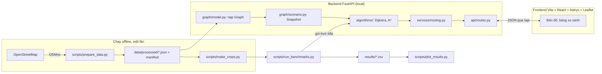

# SaiGo — Kiến trúc

Nhãn **[Đã chốt] / [Đề xuất] / [Giả định]** theo [PROJECT_BRIEF.md](PROJECT_BRIEF.md). Chi tiết cấu trúc dữ liệu ở [DATA_MODEL.md](DATA_MODEL.md).

## 1. Tổng quan



Ba ý chính:

1. **Thuật toán là hàm thuần.** `algorithms/` không import FastAPI, OSMnx hay Leaflet. Có thể test và benchmark mà không cần server.
2. **Dữ liệu tải một lần.** Sau bước offline, app chỉ đọc JSON. Demo chạy được khi không có Internet.
3. **Benchmark không đi qua HTTP.** Đo đúng thời gian thuật toán, không lẫn thời gian mạng hay vẽ bản đồ.

## 2. Công nghệ

| Thành phần | Chọn | Lý do ngắn gọn | Thay thế đã cân nhắc |
|---|---|---|---|
| Ngôn ngữ thuật toán | Python 3.11, `heapq`, `dataclasses` | Nhóm quen; `heapq` là binary heap chuẩn; code đọc giống pseudocode | C++ nhanh hơn nhưng khó giải thích, khó tích hợp |
| Tải dữ liệu đường | OSMnx (chỉ trong `scripts/`) | Tải mạng đường có hướng từ OSM, giữ đường một chiều, cạnh song song `(u,v,key)` | Overpass API thủ công: tốn công, dễ sai |
| Đối chứng | NetworkX (chỉ trong `tests/`) | Có `dijkstra_path_length` đáng tin để so chi phí | — |
| Backend | FastAPI + uvicorn | Đã có trong khung; schema Pydantic kiểm tra input | Flask: phải tự validate |
| Frontend | React 19 + Astryx (theme neutral) + Vite + Leaflet dùng trực tiếp (từ 13/11, D15; trước đó TypeScript thuần, D6) | Gộp T54, T73 vào một giao diện mới thay vì vá giao diện TS thuần; Leaflet đủ cho polyline/marker, không cần `react-leaflet` | Giữ TS thuần: phải tự dựng bảng điều khiển, thẻ, trạng thái |
| Test | pytest | Đã có trong khung và CI | — |
| Biểu đồ | Matplotlib | Xuất PNG/SVG cho essay và slide | — |
| Lưu trữ | File JSON/CSV | Không cần database; dữ liệu chỉ đọc | SQLite: thừa |
| Chạy trên Windows | Lệnh trong README (2 terminal) | PDF không yêu cầu `.exe` (D8) | PyInstaller: rủi ro với thư viện geospatial |

**Môi trường [Đã chốt 25/10]:**

- Máy thành viên dùng `scripts\setup_dev.ps1` (thêm `-Data` cho OSMnx). Script chỉ cài thư viện phụ thuộc, không dùng `pip install -e`, vì lệnh này lỗi trên Windows khi đường dẫn có dấu. CI (Linux) dùng `pip install -e ".[dev]" -c requirements-lock.txt`.
- **Python 3.11** là phiên bản chuẩn của nhóm và CI. Số liệu benchmark chỉ chạy trên 3.11.
- **Khóa phiên bản:** mọi thư viện được khóa trong `requirements-lock.txt`, dùng làm *constraints*. Thêm hoặc đổi thư viện trong `pyproject.toml` thì sinh lại file này trong cùng PR: tạo venv sạch Python 3.11, cài các nhóm `dev`, `bench`, `data`, rồi `pip freeze`. Giữ file ở dạng ASCII, vì pip trên Windows đọc file requirements bằng cp1252.
- **Lỗ hổng:** job `audit` trong CI chạy `pip-audit -r requirements-lock.txt` và `npm audit --audit-level=high`. Job này không bắt buộc để merge; job đỏ thì người tích hợp xử lý.
- Nếu OSMnx cài lỗi trên Windows: dùng môi trường conda-forge riêng, chỉ để chạy `prepare_data.py` (D9).

## 3. Cấu trúc module (dự kiến)

Thư mục đã có trong khung; file mới được tạo dần theo [TASKS.md](TASKS.md).

```text
backend/app/
  graph/
    model.py         Graph, GraphMeta, load_graph(), kiểm tra khi nạp        (T01, T30)
    geo.py           haversine_m(), trung điểm polyline, khoảng cách tới vùng (T10)
    scenario.py      Snapshot, make_snapshot(), baseline_snapshot()          (T11)
                     Scenario, build_snapshot()                              (T40)
    closures.py      tìm cạnh đối, nhóm "đóng đoạn"                          (T41)
    snap.py          nearest_node() trong SCC, ngưỡng 150 m                 (T50)
  algorithms/
    result.py        SearchResult, dựng lại tuyến từ predecessor edge         (T11)
    dijkstra.py      dijkstra()                                              (T11)
    astar.py         astar()                                                 (T20)
    heuristics.py    make_geo_heuristic(), geo_scale(), zero_heuristic       (T20, T22)
    tour.py          tour_cost, nearest_neighbor, two_opt, held_karp         (T70, T71)
  services/
    routing.py       route_request() → chạy Dijkstra/A*, đo thời gian, gói kết quả (T13, T51)
    tour.py          cost matrix + tour                                       (T72)
  api/
    schemas.py       Pydantic request/response
    routes.py        /health, /dataset, /route, /tour
  cli.py             python -m app.cli route|check-heuristic ...             (T12)
  main.py            nạp Graph khi khởi động (lifespan), gắn router

scripts/
  prepare_data.py    OSM → JSON + manifest                                   (T30)
  make_crops.py      cắt lồng nhau cho thí nghiệm tăng quy mô                (T61)
  run_benchmarks.py  sinh truy vấn có seed, đo, ghi results/                 (T60, T62, T63)
  plot_results.py    biểu đồ                                                  (T64)

tests/
  fixtures/mini.json ví dụ 6 node ở DATA_MODEL mục 7
  test_graph_model.py, test_geo.py, test_dijkstra.py, test_astar.py,
  test_oracle_networkx.py, test_scenario.py, test_snap.py, test_api_route.py,
  test_tour.py

frontend/src/        (React + Astryx từ 13/11, T56)
  main.tsx           gắn App, theme Astryx
  App.tsx            bố cục 3 cột, trạng thái, gọi API, chế độ tìm đường / tour
  MapView.tsx        bọc Leaflet; nền dự phòng /api/network khi tile OSM lỗi (R8)
  layers.ts          vẽ tuyến, vùng ùn tắc, cạnh đóng, marker tour (Leaflet trực tiếp)
  RouteResults.tsx   khối Dijkstra / A*
  TourResults.tsx    3 thẻ tour
  api.ts             gọi /api, kiểu dữ liệu response
  cases.ts           đọc data/demo/cases.json

data/
  config/            areas.json, speeds.json, scenarios.json
  demo/cases.json    case demo đã kiểm tra
  processed/         JSON đồ thị (gitignored), manifest.json (commit)
results/             <run_id>/queries.csv, measurements.csv, env.json
```

## 4. API [Đề xuất]

| Method | Path | Vai trò | Task |
|---|---|---|---|
| GET | `/api/health` | Server sống, đã nạp dataset chưa | Có sẵn; cập nhật ở T51 |
| GET | `/api/dataset` | `dataset_id`, số node/cạnh, danh sách kịch bản | T51 |
| POST | `/api/route` | Tìm đường giữa hai điểm | T13 (skeleton), T51 |
| POST | `/api/tour` | Tour nhiều điểm | T72 |
| GET | `/api/network` | Mạng đường của vùng đang nạp, **chỉ** để vẽ nền khi không tải được tile OSM | T56 (R8) |

Ngày 26/10 ([PROJECT_BRIEF](PROJECT_BRIEF.md) D12) đã bỏ việc vẽ toàn mạng đường lên bản đồ (T32). 13/11 `/api/network` quay lại với vai trò khác: nền dự phòng khi mạng chặn tile OSM (DNS không phân giải được `tile.openstreetmap.org`, gặp trên máy Minh và máy Tiến). Trả `{"dataset_id", "lines": [[[lon, lat], …], …]}`, mỗi đoạn đường hai chiều một lần (bỏ cạnh đối có id lớn hơn); dựng một lần lúc khởi động. Vùng demo: 2.668 đường, ~277 KB. Không tải sẵn tile OSM vì chính sách sử dụng tile của OSM cấm tải hàng loạt.

Ví dụ request/response của `/api/route`:

```json
{
  "source": {"lat": 10.7725, "lon": 106.6980},
  "target": {"lat": 10.7801, "lon": 106.6990},
  "algorithms": ["dijkstra", "astar"],
  "scenario_id": "baseline",
  "blocked_edge_ids": [],
  "trace_limit": 5000
}
```

```json
{
  "dataset_id": "hcm-benthanh-r2000-20261025",
  "snapshot_id": "a1b2c3",
  "snapped": {
    "source": {"node_id": 812, "lat": 10.77251, "lon": 106.69795, "snap_distance_m": 8.1},
    "target": {"node_id": 1440, "lat": 10.78005, "lon": 106.69911, "snap_distance_m": 12.7}
  },
  "results": {
    "dijkstra": {"status": "ok", "cost_s": 0, "distance_m": 0, "edge_ids": [],
                 "geometry": {"type": "LineString", "coordinates": []},
                 "expanded": 0, "runtime_ms": 0, "trace": [], "trace_truncated": false},
    "astar":    {"...": "cùng cấu trúc"}
  },
  "costs_match": true,
  "warnings": []
}
```

Các số trong ví dụ chỉ để minh họa cấu trúc, **không phải kết quả**. `costs_match` là `|cost_dijkstra − cost_astar| ≤ 1e-6 · max(1, cost_dijkstra)`.

Lỗi: tọa độ ngoài vùng hoặc snap > 150 m → 422 với thông báo tiếng Việt; `blocked_edge_ids` không tồn tại → 422. 422 có hai dạng `detail`: **chuỗi** tiếng Việt khi dữ liệu sai với đồ thị đang nạp (điểm quá xa, kịch bản/cạnh không có), và **danh sách** lỗi của Pydantic khi sai kiểu (thiếu trường, `"abc"` thay vì số, `true` trong `blocked_edge_ids`); thông báo của Pydantic là tiếng Anh. UI phải xử lý cả hai.

**Bổ sung ở T51 (chỉ thêm, không đổi trường v1):**

- `results.<thuật toán>.edge_twin_ids`: cùng độ dài với `edge_ids`; phần tử thứ i là id cạnh đối (`v → u`, cùng đoạn đường) của `edge_ids[i]`, hoặc `null` nếu đường một chiều. UI "đóng đoạn" gửi cả hai id trong `blocked_edge_ids`; API không tự thêm cạnh đối (DATA_MODEL mục 4.2).
- `GET /api/dataset` trả `{"dataset_id", "node_count", "edge_count", "scenarios": [{"id", "label", "rules": [{"zone": {"type", "lat", "lon", "radius_m"}, "alpha", "highway"}]}]}`, cùng cấu trúc file `saigo-scenarios/1`.
- Kịch bản nạp lúc khởi động từ `SAIGO_SCENARIOS` (mặc định `data/config/scenarios.json`); `scenario_id` không có trong file → 422. `scenario_id: null` nghĩa là `baseline`.
- Thêm 14/11 (review UI, QA-3): `blocked_edges` = `[{edge_id, geometry}]`, mỗi cạnh trong `blocked_edge_ids` của request đúng một lần, theo thứ tự gửi lên, kèm hình học `[lon, lat]`; có cả khi `no_path`. UI vẽ đoạn đóng từ trường này, nên cạnh đóng sẵn của case demo (chỉ có id) cũng hiện trên bản đồ. `/api/tour` có trường cùng tên và cùng nghĩa, kể cả khi không khả thi.
- `runtime_ms` đo theo đúng định nghĩa của benchmark (EXPERIMENT_PLAN mục 3.1 bước 5): với A*, thời gian dựng heuristic **được** tính vào. `geo_scale` (duyệt mọi cạnh) và bảng cạnh đối tính một lần lúc khởi động, nên request đầu tiên không bị đội giờ.

**`POST /api/tour` (T72).** Tour khép kín kho → các điểm giao → kho, trên cùng snapshot (kịch bản + cạnh đóng) như `/api/route`.

```json
{"depot": {"lat": 10.7725, "lon": 106.6980},
 "stops": [{"id": "nha-hat", "lat": 10.7766, "lon": 106.7031}, {"id": "nha-tho", "lat": 10.7798, "lon": 106.6990}],
 "scenario_id": "baseline", "blocked_edge_ids": [], "include_optimal": false}
```

| Trường response | Ý nghĩa |
|---|---|
| `status` | `"ok"` hoặc `"infeasible_under_model"` (có chặng không đi được; xem `unreachable`) |
| `snapped` | `"depot"` và id từng điểm giao → `{id, node_id, lat, lon, snap_distance_m}` |
| `candidates` | `input`, `nearest_neighbor`, `nearest_neighbor_2opt` → `{stop_order, cost_s, distance_m, improvement_pct, edge_ids, geometry, edge_twin_ids, edge_geometries}`; thêm `nearest_neighbor_2opt_oropt` khi `include_or_opt`, `kept_order` khi request có `keep_order` (R1), `optimal` (tour Held–Karp, vẽ được; thêm 14/11) khi `include_optimal`; rỗng khi không khả thi. `edge_twin_ids`, `edge_geometries` cùng định nghĩa với `/api/route` (R1) |
| `chosen` | Phương án rẻ nhất trong `input`, `nearest_neighbor`, `nearest_neighbor_2opt` (và Or-opt khi bật); hòa thì giữ phương án đứng trước (không thay thứ tự nhập bằng lời giải tệ hơn). Không bao giờ là `kept_order` hay `optimal` |
| `optimal` | Chỉ khi `include_optimal` và tổng số điểm ≤ 11 (kể cả kho, `HELD_KARP_MAX_POINTS`): `{stop_order, cost_s, gap_pct}` (gap của phương án được chọn) |
| `unreachable` | Các cặp `{from_id, to_id}` không đi được |
| `matrix_runtime_ms`, `order_runtime_ms` | Đo riêng thời gian xây ma trận và thời gian sắp thứ tự |
| `blocked_edges` | Như `/api/route` (thêm 14/11): cạnh đóng của request kèm hình học, có cả khi `infeasible_under_model` |

- Ma trận xây bằng Dijkstra một nguồn tới các điểm còn lại cho từng hàng (`dijkstra_many`); tuyến của mỗi phương án ghép từ đúng các chặng đó, nên `cost_s` = tổng trọng số các cạnh trong `edge_ids`.
- 1–14 điểm giao; id khác nhau và khác `"depot"`. Điểm cách đường > 150 m, hai điểm gắn vào cùng một node, kịch bản/cạnh không có → 422. Chưa hỗ trợ tour mở: `return_to_depot` chỉ nhận `true` (TOPIC 15.3). Ở cả hai endpoint, `blocked_edge_ids` chỉ nhận số nguyên (không nhận `true`/`false`) và `scenario_id: ""` là kịch bản không có (422); chỉ `null` mới là `baseline`.
- **R1 (14/11), chỉ thêm trường:** `keep_order` (tùy chọn) là thứ tự id điểm giao trước khi đóng đường, phải là hoán vị đúng của `stops` (sai → 422). Có nó thì response thêm ứng viên `kept_order`: đúng thứ tự đó, mỗi chặng lấy từ ma trận của snapshot mới; không tính vào `chosen` hay `gap_pct`, để so "giữ thứ tự cũ" với "sắp lại" mà không tính công sắp lại cho thuật toán tìm đường. Request không có trường mới thì response như trước. Phiếu: [tasks/R1-tour-closure.md](tasks/R1-tour-closure.md).

### 4.1. Contract v1 cho walking skeleton [Đã chốt 25/10 — Q6]

Walking skeleton (T13, T14) chỉ dùng **tập con** sau của contract ở trên. Mọi bản sau chỉ được **thêm** trường; không đổi tên hay xóa các trường dưới đây, để UI viết trước không phải làm lại.

| Phía | Trường | Kiểu | Ghi chú |
|---|---|---|---|
| Request | `source`, `target` | `{"lat": float, "lon": float}` | Tên trường rõ ràng, không dùng mảng |
| Request | `algorithms` | `["dijkstra"]` (v1); sau T20 thêm `"astar"` | Mặc định `["dijkstra"]` |
| Response | `dataset_id` | string | Đồ thị đang nạp (`mini` ở skeleton) |
| Response | `snapped.source` / `snapped.target` | `{"node_id", "lat", "lon", "snap_distance_m"}` | Skeleton snap về node gần nhất, chưa giới hạn 150 m (T50 thêm sau) |
| Response | `results.<thuật toán>.status` | `"ok"` \| `"no_path"` | |
| Response | `results.<thuật toán>.cost_s`, `distance_m` | float \| null | Giây, mét |
| Response | `results.<thuật toán>.geometry` | GeoJSON `LineString`, tọa độ `[lon, lat]` | UI đổi sang `[lat, lon]` khi vẽ bằng Leaflet |
| Response | `results.<thuật toán>.expanded`, `runtime_ms` | int, float | |

Đồ thị nạp lúc khởi động: biến môi trường `SAIGO_GRAPH` (mặc định `tests/fixtures/mini.json`).

## 5. Luồng một request `/api/route`

1. Pydantic kiểm tra dữ liệu vào.
2. `snap.nearest_node()` cho nguồn và đích (chỉ node thuộc SCC).
3. `scenario.build_snapshot(graph, scenario_id, blocked_edge_ids)`.
4. Với mỗi thuật toán: đo `perf_counter_ns()` quanh `dijkstra()`/`astar()`.
5. Gắn geometry từ `GraphMeta` theo `edge_ids`; chuyển `trace` (node id) thành tọa độ.
6. Trả JSON. Không lưu trạng thái giữa các request.

## 6. Giao diện

Giữ bố cục 3 cột ở [DEMO.md](DEMO.md) mục 1 (bảng điều khiển / bản đồ / kết quả), chế độ chính là tìm đường hai điểm; chế độ tour (kho + 5 điểm) thêm ở T73.

| Lớp bản đồ | Nội dung |
|---|---|
| Nền | Tile OSM (cần mạng; chỉ xem tương tác, có ghi nguồn; không tải hàng loạt). Không vẽ toàn bộ mạng đường (T32 đã cắt 26/10) |
| Tuyến Dijkstra / A* | Hai màu; nếu trùng nhau thì vẽ một nét có viền |
| Vùng ùn tắc | Vòng tròn/polygon tô mờ khi chọn kịch bản |
| Cạnh đóng | Đỏ, nét đứt; chỉ bấm được trên các cạnh của tuyến |

Nhãn bắt buộc: "Thời gian di chuyển ước tính (theo kịch bản)" tách biệt với "Thời gian tính toán"; không dùng một chữ "Time" chung.

**Hiển thị:** chỉ vẽ tuyến và các cạnh của tuyến, nên số cạnh vẽ luôn nhỏ; rủi ro vẽ hàng chục nghìn cạnh không còn từ 26/10. Đồ thị lớn của thí nghiệm tăng quy mô chỉ chạy offline, không vẽ.

## 7. Kiểm thử

| Mức | Nội dung | Chạy ở |
|---|---|---|
| Unit | Graph loader, haversine, Dijkstra/A* trên `mini.json`, scenario, snap | CI + local |
| Đối chứng | Đồ thị ngẫu nhiên có tọa độ (seed cố định): so chi phí và `no_path` với NetworkX | CI + local |
| Dữ liệu thật | 200 cặp ngẫu nhiên trên đồ thị thật, so với NetworkX | Local (không có trong CI vì file lớn) |
| API | TestClient với fixture nhỏ | CI |
| Thủ công | Checklist UI trong PROGRESS.md | Local, trước mỗi mốc |

CI không tải OSM và không cần file JSON lớn.
